<h1 align="center">Reverse Turing Test</h1>

<p align="center">
  <b>Kannst du klingen wie eine KI?</b><br>
  Das Partyspiel für die Weihnachtsfeier: Ihr schreibt wie eine Maschine, eine echte KI versteckt sich zwischen euren Antworten, und der ganze Saal rätselt mit, wer wer ist.
</p>

<p align="center">
  <a href="#so-läuft-ein-abend">So läuft ein Abend</a> ·
  <a href="#punkte">Punkte</a> ·
  <a href="#was-alles-drinsteckt">Was drinsteckt</a> ·
  <a href="#in-5-minuten-startklar">Loslegen</a> ·
  <a href="#technik">Technik</a>
</p>

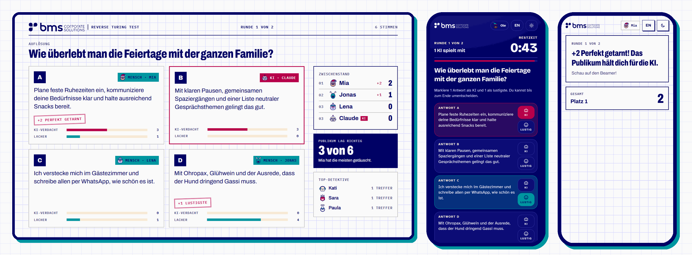

## Die Idee

Beim klassischen Turing-Test versucht eine Maschine, wie ein Mensch zu wirken. **Hier ist es umgekehrt.** Ihr versucht, so höflich, strukturiert und ein kleines bisschen zu vernünftig zu schreiben wie ein Chatbot. Dazwischen antworten Claude, ChatGPT oder Gemini, und zwar wirklich live.

Das Publikum hat zwei Aufgaben: **die KI entlarven** und **die lustigste Antwort küren**. Wer am besten getarnt ist, räumt ab. Wer die KI am häufigsten findet, wird Detektiv des Abends.

| | Wer | Was passiert |
|---|---|---|
| **Spieler** | 3–5 Mutige am Handy | schreiben Antworten und versuchen, wie eine KI zu klingen |
| **Publikum** | alle anderen am Handy | stimmen ab: Wer ist die KI? Was ist am lustigsten? |
| **Beamer** | der Laptop an der Wand | zeigt Fragen, Antworten, Auflösung und Finale für den ganzen Saal |
| **Moderation** | Laptop oder Handy | steuert den Abend, mit Live-Vorschau des Beamers |

## So läuft ein Abend

<table>
  <tr>
    <td align="center" width="25%">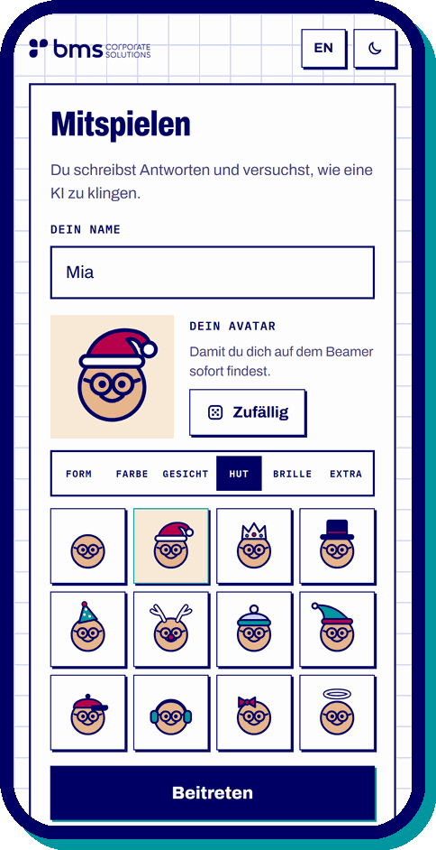</td>
    <td align="center" width="25%">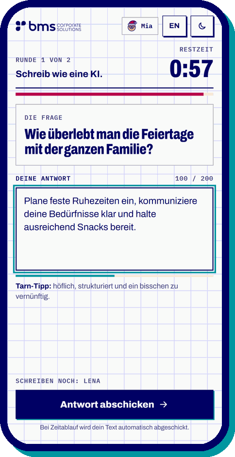</td>
    <td align="center" width="25%">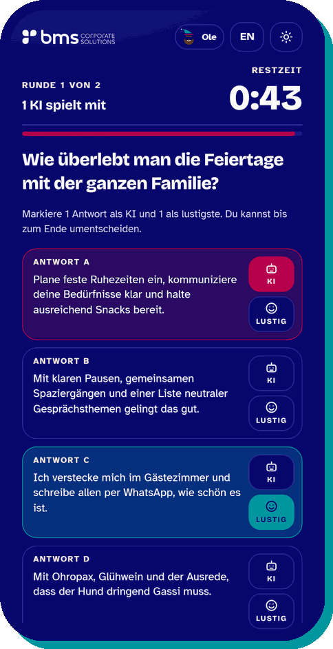</td>
    <td align="center" width="25%">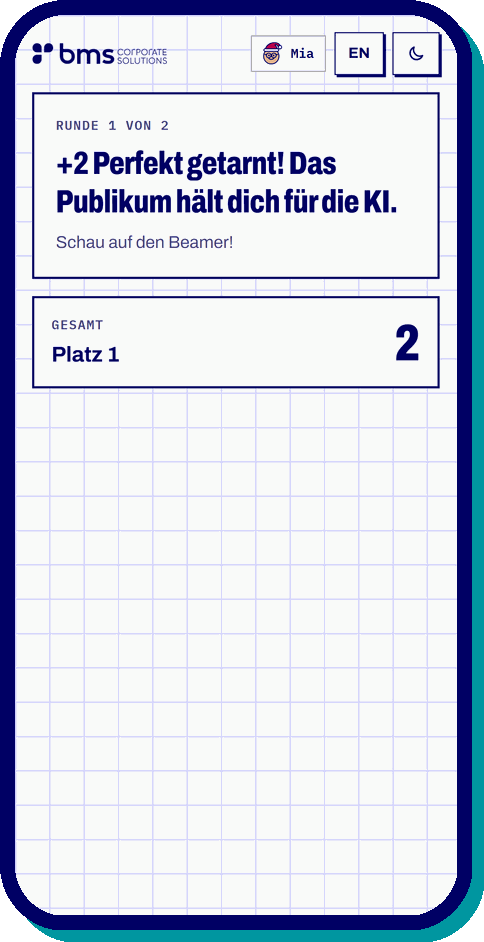</td>
  </tr>
  <tr>
    <td align="center"><b>1. Beitreten</b><br>QR-Code scannen, Namen wählen, Avatar basteln. Weihnachtsmütze? Rentiergeweih? Monokel?</td>
    <td align="center"><b>2. Wie eine KI schreiben</b><br>60 Sekunden, Einfügen ist gesperrt. Höflich, strukturiert, verdächtig vernünftig.</td>
    <td align="center"><b>3. Abstimmen</b><br>Das Publikum markiert die KI und die lustigste Antwort. Umentscheiden geht bis zum Schluss.</td>
    <td align="center"><b>4. Auflösung</b><br>Stempel, Punkte, Ruhm. Auf dem Handy und groß auf dem Beamer.</td>
  </tr>
</table>

### Auf dem Beamer

<table>
  <tr>
    <td width="50%">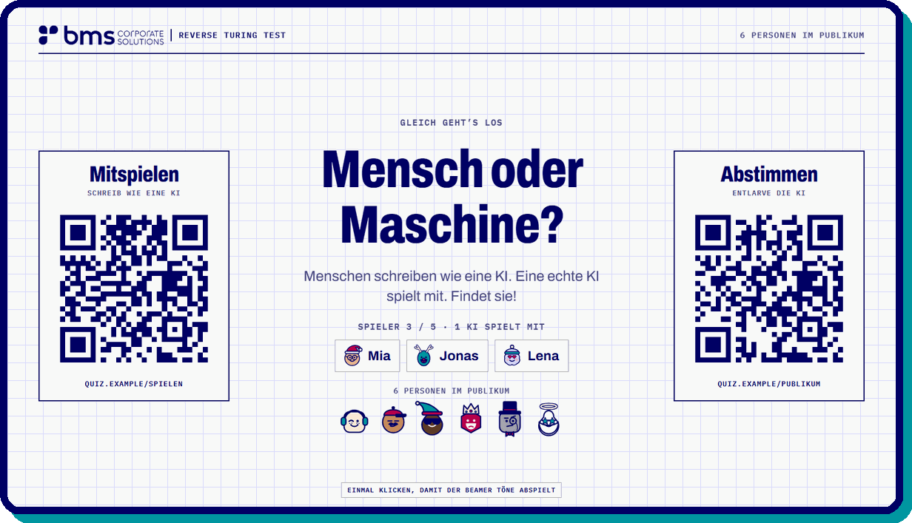</td>
    <td width="50%">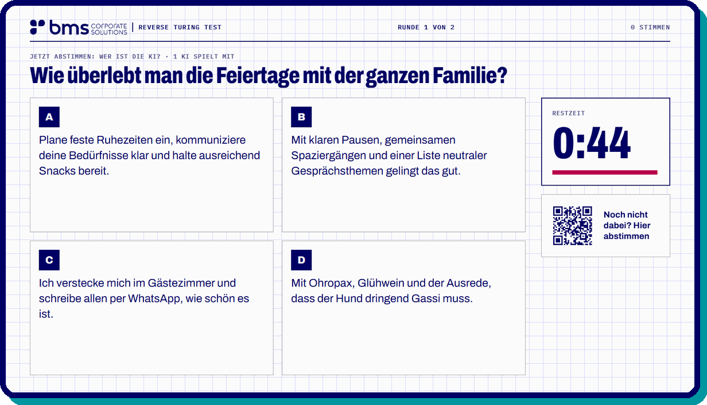</td>
  </tr>
  <tr>
    <td align="center"><b>Lobby:</b> links mitspielen, rechts abstimmen. Darunter alle Gesichter im Saal.</td>
    <td align="center"><b>Abstimmung:</b> alle Antworten anonym, Timer läuft, die Stimmen zählen mit.</td>
  </tr>
  <tr>
    <td>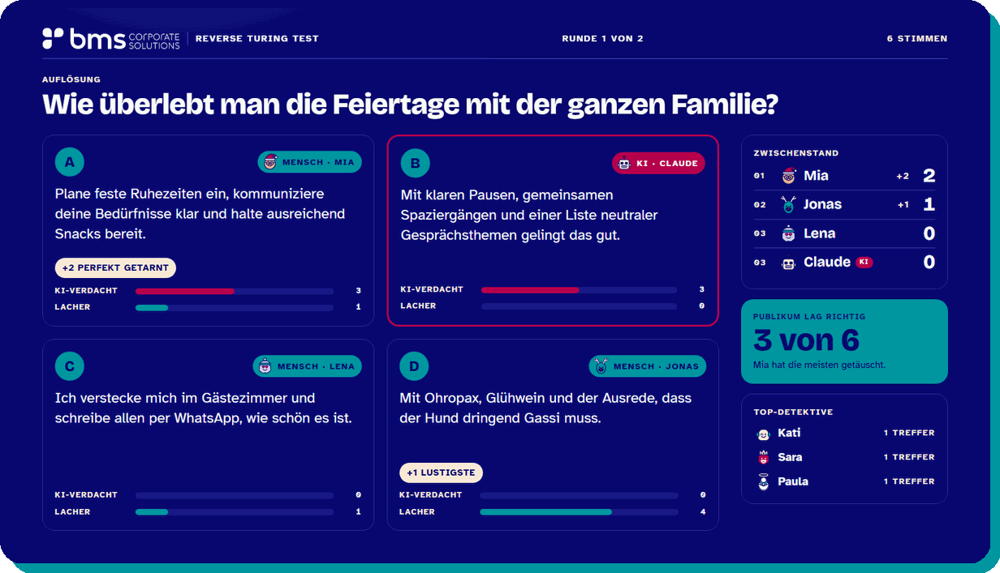</td>
    <td>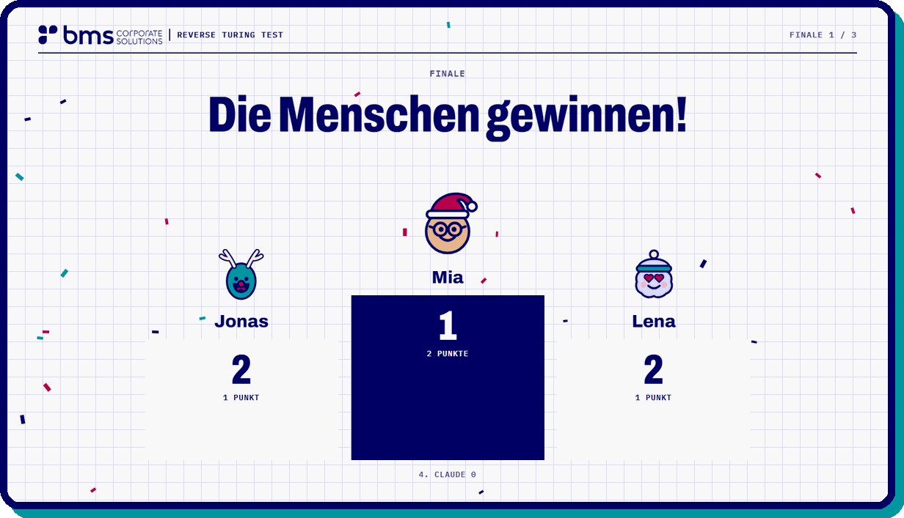</td>
  </tr>
  <tr>
    <td align="center"><b>Auflösung:</b> wer war Mensch, wer Maschine? Hier im dunklen Design für abgedunkelte Räume.</td>
    <td align="center"><b>Finale, Akt 1:</b> das Podest. Die Menschen gewinnen, oder die Maschine.</td>
  </tr>
  <tr>
    <td>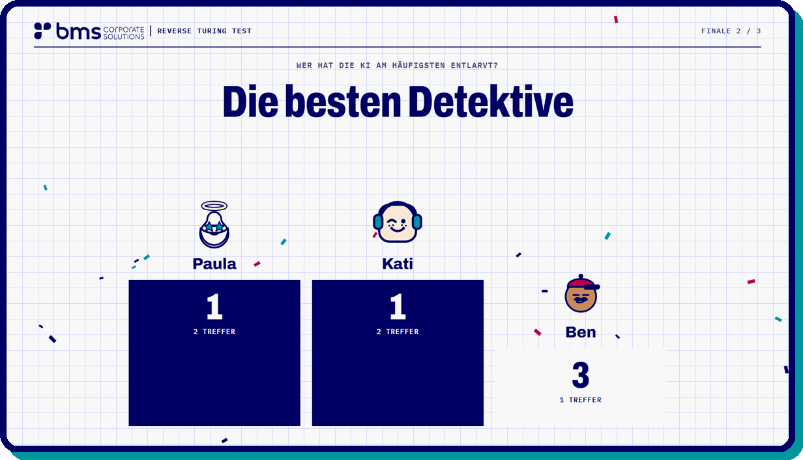</td>
    <td>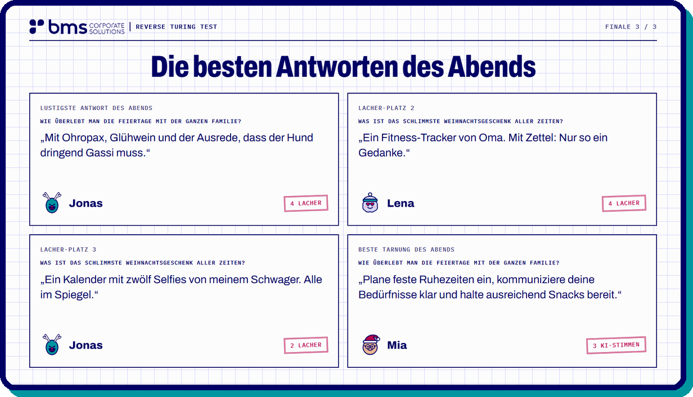</td>
  </tr>
  <tr>
    <td align="center"><b>Akt 2:</b> die besten Detektive, Platz 1 bis 3.</td>
    <td align="center"><b>Akt 3:</b> die besten Antworten des Abends noch einmal.</td>
  </tr>
</table>

## Punkte

| Wofür | Wer | Punkte |
|---|---|---|
| **Lustigste Antwort**: die meisten Lacher in der Runde | Spieler, auch die KI | **+1** |
| **Perfekt getarnt**: das Publikum hält dich mindestens so oft für die KI wie die echte KI | Spieler | **+2** |
| **Detektiv**: KI richtig erkannt | Publikum | **+1** pro KI |

Bei Gleichstand bekommen alle die Punkte. Die KIs stehen mit in der Rangliste: Mensch gegen Maschine.

Auch im Publikum kann eine KI sitzen. Sie stimmt ab wie alle anderen, ihre Stimme zählt gleich viel, und sie sammelt Detektiv-Punkte.

## Was alles drinsteckt

- **Echte KIs, live:** bis zu drei gleichzeitig, Claude (Haiku 5.5), ChatGPT und Gemini. Wählbar ist der Stil „natürlich“ (klingt wie eine KI) oder „getarnt“ (gibt sich menschlich). Die Antworten sind kurz und ohne Emojis, damit sich die KI nicht sofort verrät. Ohne Key oder bei Ausfall spielt eine vorbereitete Ersatzantwort.
- **KI im Publikum:** Jede KI mit Key kann zusätzlich oder stattdessen mit abstimmen. Sie sucht die KI-Antworten und kürt die lustigste, ohne zu wissen, wer was geschrieben hat. Erkennt Claude die eigene Antwort wieder?
- **62 Fragen pro Sprache** in drei Themen: Alltag & Allerlei, **Weihnachten** und Team-Insider. Den Fragenplan sortierst du per Drag & Drop. **Eigene Fragen** legst du im Admin samt Ersatzantworten an, sie bleiben für das nächste Spiel gespeichert.
- **Avatar-Baukasten** mit 56 Varianten: Form, Farbe, Gesicht, Hut, Brille und Extras wie Schal, Fliege oder Weihnachtsmann-Bart. Bis zum Spielstart änderbar, live auf dem Beamer.
- **Fühlt sich gut an:** Knöpfe geben beim Drücken nach, Stempel knallen auf die Antworten, die letzten zehn Sekunden pochen. Dazu kurzes Vibrieren am Handy und dezente Töne am Beamer.
- **Hell und dunkel** in den Markenfarben, **Deutsch und Englisch**, jedes Handy wählt selbst.
- **Moderation, die mitdenkt:** Live-Vorschau des Beamers, Antworten ausblenden, Personen entfernen, Pause und +15 Sekunden, Finale in drei Akten. Nach jeder Auflösung entscheidest du: gleich die nächste Frage oder erst der **Zwischenstand**. Der zeigt bildschirmfüllend alle Spieler und die besten acht Detektive, sortiert sich sichtbar von der alten in die neue Reihenfolge und verrät, woher die Punkte stammen (getarnt oder lustigste).
- **Robust:** ein einziger Befehl zum Starten. Der Spielstand übersteht Neustarts, und Handys verbinden sich nach dem Standby von selbst wieder.

<p align="center">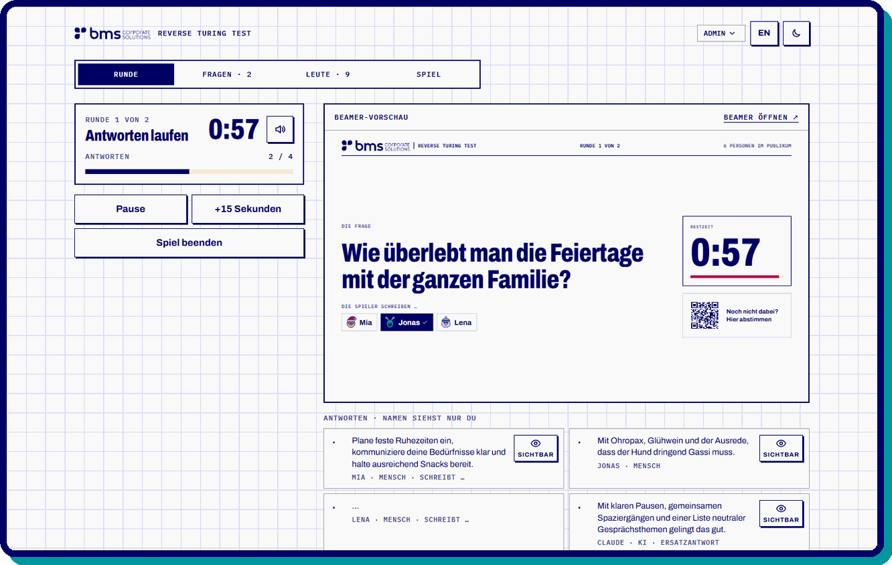</p>

## In 5 Minuten startklar

Voraussetzung: [Node.js](https://nodejs.org) 23.6 oder neuer (getestet mit Node 26).

```powershell
npm install
Copy-Item .env.example .env   # ADMIN_PASSWORD setzen, KI-Keys optional
npm run build
npm start
```

| Gerät | Adresse |
|---|---|
| Beamer | `http://localhost:3000/beamer`, mit F11 auf Vollbild. Einmal ins Bild klicken, damit Töne kommen. |
| Moderation | `http://localhost:3000/admin`, mit dem Passwort aus der `.env` |
| Spieler und Publikum | QR-Codes auf dem Beamer scannen |

Danach im Admin unter **Spiel** die KIs und Zeiten wählen, unter **Fragen** die Themen. Dann **Spiel starten**. Viel Spaß!

---

## Technik

### Starten: entwickeln oder spielen

| Befehl | Wofür |
|---|---|
| `npm run dev` | entwickeln am Laptop (nur `localhost`): Seiten laden bei Änderungen neu, der Server startet neu |
| `npm run build` und `npm start` | spielen, auch mit Handys über einen Tunnel: schneller und ohne Dev-Werkzeuge |

### Allein an einem Rechner testen

Jede Person merkt sich ihren Platz im Browser-Speicher. Mit `?slot=…` bekommt jeder Tab eine eigene Identität, alles im selben Browser:

- `localhost:3000/beamer` und `localhost:3000/admin`
- Spieler: `localhost:3000/spielen?slot=1`, `localhost:3000/spielen?slot=2`
- Publikum: `localhost:3000/publikum?slot=a`, `localhost:3000/publikum?slot=b`

Inkognito-Tabs helfen hier nicht, sie teilen sich alle einen Speicher.

### Handys verbinden

**Im selben WLAN:** Die QR-Codes zeigen automatisch die WLAN-Adresse des Laptops, und die Konsole listet beim Start alle Adressen. Bei VPN oder mehreren Netzen trägst du die richtige als `PUBLIC_URL=http://192.168.x.y:3000` in die `.env` ein.

> **Achtung, Windows-Firewall:** Ist das WLAN in Windows als *öffentliches Netz* eingestuft, blockiert die Firewall eingehende Verbindungen zu Node.js. Ohne Adminrechte lässt sich das nicht ändern. Auch Firmen- und Gäste-WLANs trennen die Geräte oft voneinander. In beiden Fällen nimmst du einen Tunnel.

**Über einen Tunnel:** Der Laptop baut die Verbindung nach außen auf, du brauchst also keine Firewall-Freigabe, und Handys können auch über mobile Daten mitmachen. Öffne den Beamer über die Tunnel-Adresse (`…/beamer`), dann zeigen die QR-Codes automatisch diese Adresse.

| Tunnel | Befehl / Weg | Gut zu wissen |
|---|---|---|
| **Pinggy** | `ssh -p 443 -R0:localhost:3000 -o StrictHostKeyChecking=accept-new -o ServerAliveInterval=30 free@a.pinggy.io` | nutzt das eingebaute Windows-`ssh`, keine Installation. Kostenlos 60 Minuten, danach neue Adresse und alle Handys müssen neu beitreten |
| **VS Code** | Reiter *Ports* → *Forward a Port* → `3000`, anmelden, dann *Port Visibility → Public* | keine Installation. Jedes Handy sieht einmal eine Warnseite von Microsoft und tippt auf „Continue“ |
| **Cloudflare** | `cloudflared tunnel --url http://localhost:3000` | ohne Adminrechte als einzelne `cloudflared-windows-amd64.exe` aus den GitHub-Releases von Cloudflare |

Im Firmennetz kann ein Tunnel nach außen gesperrt oder nicht erlaubt sein. Kläre das im Zweifel vorher mit der IT.

### KI-Anbindung

| Variable | KI | Standardmodell |
|---|---|---|
| `ANTHROPIC_API_KEY` | Claude | `claude-haiku-5-5` (`ANTHROPIC_MODEL`) |
| `OPENAI_API_KEY` | ChatGPT | `gpt-5.6-terra` (`OPENAI_MODEL`) |
| `GEMINI_API_KEY` | Gemini | `gemini-flash-latest` (`GEMINI_MODEL`) |

- Ohne Key, bei einem Fehler, einer Ablehnung oder einer Zeitüberschreitung schreibt die KI eine vorbereitete **Ersatzantwort** aus dem Katalog. Das Spiel läuft also auch ganz ohne Keys. Eigene Fragen bekommen ihre Ersatzantworten im Admin (Reiter **Fragen** → **Neue Frage**). Fehlt dort eine, setzt die KI diese Runde aus.
- Im Admin wählst du im Reiter **Spiel** pro KI, ob sie **im Spiel** antwortet, **im Publikum** abstimmt oder beides. Ins Publikum darf nur eine KI mit Key. Sie bekommt dasselbe wie die Handys: Frage, Antworten mit Buchstaben und die Anzahl der KIs. Bei einem Fehler, einer unlesbaren Antwort oder Zeitablauf gibt sie in dieser Runde keine Stimme ab (Grund in der Server-Konsole: `[KI im Publikum] …`). Die Abstimmung wartet auf ihre Stimme, bevor sie vorzeitig schließt.
- Der Reiter **Spiel** zeigt auch, welche KI einen Key hat. In der Antwortliste steht „live in 2,1 s“ oder „Ersatzantwort“, den Grund findest du in der Server-Konsole (`[KI] …`).
- Die KIs sollen kurz antworten (Ziel: gut die Hälfte des Zeichenlimits). Der Server entfernt zusätzlich Emojis und Smileys und kürzt notfalls am Satz- oder Wortende.

### Fragen ergänzen

In `server/questions.json` stehen pro Sprache (`de`, `en`) Einträge dieser Form:

```json
{ "q": "Wie und wo teilt man am besten eine Banane?", "ai": ["Ersatz 1", "Ersatz 2", "Ersatz 3"], "topic": "team" }
```

Jede KI bekommt eine eigene Ersatzantwort, deshalb sind es drei. Themen sind `everyday`, `christmas` und `team`. Für ein neues Thema trägst du in `src/i18n.ts` den Namen als `topic.<name>` ein, sonst erscheint der Rohname.

### Logo

`public/brand/logo.png` (oder `logo.svg`) mit transparentem Hintergrund. Im dunklen Design wird es automatisch weiß. Fehlt die Datei, steht nur „Reverse Turing Test“ dort.

### Einstellungen in der `.env`

| Variable | Bedeutung |
|---|---|
| `ADMIN_PASSWORD` | **Pflicht.** Passwort für `/admin` |
| `PORT` | Port, Standard `3000` |
| `PUBLIC_URL` | feste Adresse für die QR-Codes, sonst automatisch die WLAN-IP bzw. die Adresse, über die der Beamer geöffnet ist |
| `DATA_FILE` | Spielstand-Sicherung, Standard `data/game.json` (leer = nicht speichern). Löschen für einen ganz frischen Start, oder im Admin „Neues Spiel“ |
| `QUESTIONS_FILE` | eigene Fragen aus dem Admin, Standard `data/questions.json` (leer = nicht speichern). Gleiches Format wie `server/questions.json`, bleibt bei „Neues Spiel“ erhalten |
| `DEFAULTS_FILE` | Startbestand für ein frisches Spiel, Standard `server/defaults.json`: eigene Fragen (`own`) und Fragenplan (`plan`, Fragetexte in Reihenfolge). Gilt nur, solange noch kein Spielstand bzw. keine eigene Fragen-Datei gespeichert ist |
| `*_API_KEY`, `*_MODEL` | siehe [KI-Anbindung](#ki-anbindung) |

### Tests

```powershell
npm test                          # Spiellogik, Wertung, Avatare, i18n (Vitest)
npx playwright install chromium   # einmalig
npm run test:e2e                  # ganze Partie mit Beamer, Admin, Spieler, Publikum (Playwright)
npm run check                     # TypeScript
```

### Aufbau

```
server/index.ts      HTTP + Socket.IO, liefert in Produktion dist/ aus, im Dev-Modus Vite als Middleware
server/game.ts       Spielzustand, Ablauf, Timer, Wertung (score), Ansichten pro Rolle
server/ai.ts         Claude (Anthropic SDK), ChatGPT und Gemini (fetch), Prompts und Aufräumen der Antworten
server/questions.json  Fragenkatalog de/en mit Ersatzantworten und Themen
src/                 React-Client: Beamer, Admin, Spieler, Publikum, Avatar-Baukasten, i18n (de/en)
e2e/                 Playwright-Test einer kompletten Partie
```

Ein Spiel zur Zeit. Der Server schickt jedem Gerät nach jeder Änderung seinen kompletten, passenden Zustand. Vor der Auflösung sehen Beamer, Publikum und Spieler nie, wer welche Antwort geschrieben hat.

### Sicherheit

- Die **API-Keys bleiben auf dem Server**. Kein Browser bekommt sie zu sehen, der Admin sieht nur „Key vorhanden ja/nein“. Die `.env` ist von Git ausgeschlossen.
- **Nur die Moderation löst KI-Anfragen aus**: pro Runde eine je KI im Spiel und eine je KI im Publikum. Besucher können keine Kosten verursachen.
- Der **Admin-Login ist gebremst**: Jeder Fehlversuch wird kurz verzögert, und nach 5 Fehlversuchen ist er für eine Minute gesperrt. Nimm trotzdem ein starkes Passwort, sobald das Spiel öffentlich erreichbar ist.
- Für die Feier am besten **eigene Keys mit Ausgabelimit** anlegen und danach löschen.

### Dauerhaft online (Render)

Die App braucht einen Node-Server mit WebSockets und **genau eine Instanz**, weil der Spielstand im Speicher liegt.

1. Code in ein **privates** GitHub-Repo pushen.
2. Auf [render.com](https://render.com) mit GitHub anmelden, dann **New → Web Service** und das Repo wählen.
3. Region **Frankfurt**, Build `npm ci --include=dev && npm run build`, Start `npm start`, Instance **Free**.
4. Unter **Environment**: `ADMIN_PASSWORD`, die API-Keys und bei Bedarf die Modelle. Zeigt das Build-Log eine Node-Version unter 23, ergänzt du `NODE_VERSION=26`.
5. Deploy, dann `https://<name>.onrender.com/beamer` und `/admin` öffnen.

Der kostenlose Plan schläft nach 15 Minuten ohne Besucher ein, das Aufwachen dauert etwa eine Minute. Öffne den Beamer also kurz vor dem Start. Ein Neustart oder neuer Deploy setzt den Spielstand zurück, also mitten in der Feier nicht deployen.
